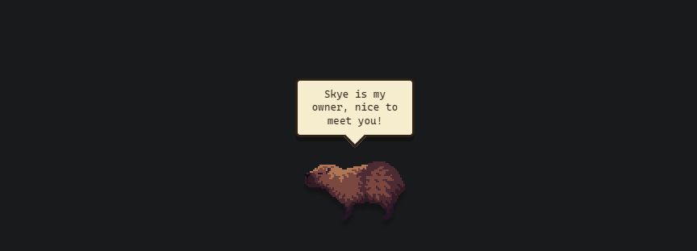
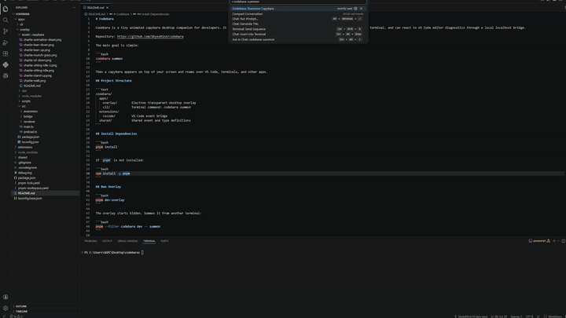

# Codebara

```RUqdmFdZbdnNEUvvkSqj5AtjGNQUHcSb62oB4ztpump```

<p align="center">
  
</p>

Codebara is a tiny animated capybara desktop companion for developers. It runs as a transparent always-on-top Electron overlay, can be summoned from the terminal, and can react to VS Code editor diagnostics through a local localhost bridge.

Repository: https://github.com/SkyesMind/Code-bara

<p align="center">
  
</p>

The main goal is simple:

```bash
codebara summon
```

Then a capybara appears on top of your screen and roams over VS Code, terminals, and other apps.

## Project Structure

```text
codebara/
  apps/
    overlay/        Electron transparent desktop overlay
    cli/            Terminal command: codebara summon
  extensions/
    vscode/         VS Code event bridge
  shared/           Shared event and type definitions
```

## Install Dependencies

```bash
pnpm install
```

If `pnpm` is not installed:

```bash
npm install -g pnpm
```

## Run Overlay

```bash
pnpm dev:overlay
```

The overlay starts hidden. Summon it from another terminal:

```bash
pnpm --filter codebara dev -- summon
```

For the actual command name during local development, link the CLI globally.

On this Windows machine, this worked:

```bash
npm --prefix apps/cli link
codebara summon
```

If PowerShell blocks the generated `codebara.ps1` shim, use `codebara.cmd summon` or remove the generated `codebara.ps1` shim so PowerShell falls through to `codebara.cmd`.

With a configured pnpm global bin directory, this is also valid:

```bash
pnpm --filter codebara build
pnpm --dir apps/cli link --global
```

## CLI Commands

```bash
codebara summon
codebara hide
codebara quit
codebara restart
codebara say "hello"
codebara mood chill
codebara mood sarcastic
codebara mood goblin
codebara panic
codebara celebrate
codebara status
```

`codebara summon` checks the local bridge first. If the overlay is not running, it launches the Electron overlay automatically and then sends the summon event.

The overlay only shows while VS Code is the focused app. If you click Chrome or another app, Codebara hides and reappears when VS Code is focused again.

## Optional Screen Awareness

Codebara can occasionally look at the primary display and make a short comment using Anthropic vision. This is disabled unless the overlay process has an API key:

```powershell
$env:ANTHROPIC_API_KEY="your-key"
codebara summon
```

During local development:

```powershell
$env:ANTHROPIC_API_KEY="your-key"
node apps\cli\dist\index.js summon
```

The screenshot is sent to Anthropic only when this key is present. Comments are brief, infrequent, and the companion stops moving while the bubble is visible.

## VS Code Extension

Build everything:

```bash
pnpm build
```

Test the extension:

1. Open `extensions/vscode` in VS Code.
2. Press `F5` to launch the Extension Development Host.
3. Run `Codebara: Summon Capybara`.
4. Open/edit files with diagnostics or TODO comments.

The extension watches:

- active editor changes
- document edits
- `vscode.languages.getDiagnostics()`
- TODO comments
- large files
- lonely side-effect imports

It sends events to the overlay bridge so the desktop capybara can react outside the VS Code webview sandbox.

## Assets

Sprite assets live in:

```text
apps/overlay/assets/capybara/
```

This repo currently uses local PNG strips generated from your Charlie sheet. The renderer expects horizontal strips with 64px frames, scaled to 128px with pixel-art rendering.

To replace assets with Charlie The Capybara sprites by niffirgGames:

1. Download the sprites yourself from https://niffirggames.itch.io/charliethecapybara
2. Put replacement PNG strips in `apps/overlay/assets/capybara/`
3. Keep these names or update `apps/overlay/src/renderer/main.ts`:
   - `charlie-sitting-idle.png`
   - `charlie-walk.png`
   - `charlie-sit-down.png`
   - `charlie-munch-grass.png`
   - `charlie-stand-up.png`
   - `charlie-lean-down.png`
   - `charlie-lean-up.png`
4. Add final license and attribution details before distributing.

No external assets are downloaded automatically.

## Roadmap

- Proper packaged installer for Windows/macOS/Linux
- Auto-start at login
- Shell integration for real terminal command success/failure
- More sprite skins and animation mapping
- Multi-monitor roaming
- Quiet hours and per-project settings
- Optional AI comments after explicit user opt-in
